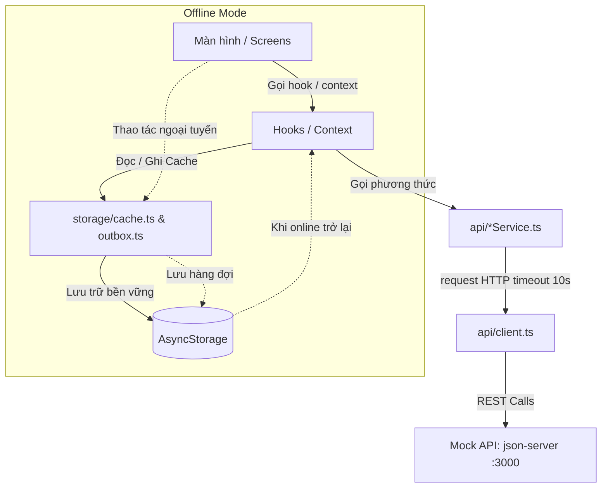

# StudyManager - Ứng dụng Quản lý Học tập (Thực hành 4: REST API & Chế độ Offline)

Ứng dụng di động quản lý học tập đa nền tảng được phát triển bằng **React Native CLI (TypeScript)**, kết nối REST API với server giả lập `json-server`, hỗ trợ chế độ hoạt động ngoại tuyến (**Offline Mode**) và cơ chế tự động đồng bộ (**Auto-sync & Outbox Queue**).

---

## 1. Tính năng nổi bật

### A. Kết nối REST API & Quản lý trạng thái
- **Kiến trúc phân tầng sạch (Clean Layered Architecture)**: Màn hình không gọi trực tiếp API mà thông qua Custom Hooks và tầng Services (`studentService`, `courseService`, `sessionService`, `assignmentService`, `gradeService`).
- **Tầng Client chuẩn hóa (`api/client.ts`)**: Timeout 10 giây, chuẩn hóa mã lỗi HTTP/Network/Timeout.
- **Xử lý trọn vẹn 4 trạng thái giao diện**: Đang tải (`LoadingView`), Có dữ liệu, Danh sách rỗng (`EmptyState`), Lỗi kèm nút thử lại (`ErrorView`).
- **Kéo để làm mới (`Pull to Refresh`)**: Tích hợp trên tất cả các danh sách màn hình.
- **Thêm bài tập mới (POST)**: Form nhập liệu có validation (tiêu đề không để trống, hạn nộp không ở quá khứ).
- **Cập nhật lạc quan (Optimistic Update)**: Đổi trạng thái bài tập (`todo` ↔ `done`) phản hồi tức thì trên UI; tự động hoàn tác và thông báo nếu API thất bại.

### B. Chế độ Ngoại tuyến (Offline Mode) & Tự đồng bộ
- **Theo dõi kết nối mạng (`useNetworkStatus`)**: Banner cảnh báo *"Bạn đang offline"* hiển thị đồng bộ trên toàn bộ ứng dụng qua `ScreenContainer`.
- **Chiến lược "Cache trước - Mạng sau" (Cache-first, Network-fallback)**:
  - Dữ liệu luôn được đọc lập tức từ `AsyncStorage` khi mở app kèm thời điểm `LastUpdatedText` (*"Cập nhật lần cuối: HH:mm, dd/MM/yyyy"*).
  - Tự động gọi API cập nhật nền khi có mạng.
- **Hàng đợi thao tác ngoại tuyến (Outbox Queue)**:
  - Khi offline, các thao tác đổi trạng thái bài tập, thêm bài tập mới hoặc sửa thông tin cá nhân không bị chặn.
  - Các thao tác được lưu tuần tự vào `AsyncStorage` theo định dạng `{ id, method, url, body, createdAt }`.
  - Item chưa đồng bộ hiển thị nhãn nổi bật `SyncBadge` (*"Chưa đồng bộ"*).
- **Tự động đồng bộ (Auto-sync)**:
  - Khi thiết bị có mạng trở lại, hook `useOutboxSync` tự động gửi tuần tự các thao tác trong hàng đợi lên server.
  - Sau khi đồng bộ thành công, hiển thị thông báo *"Đã đồng bộ X thay đổi lên máy chủ"*.
- **Xử lý xung đột (Conflict Resolution - B5)**:
  - So sánh trường thời gian `updatedAt` giữa bản ghi trên server và thao tác trong Outbox.
  - Nếu dữ liệu server mới hơn thay đổi offline: Hệ thống ưu tiên dữ liệu server, hủy thao tác cũ và hiển thị thông báo cho người dùng.

### C. Quản lý Kết quả học tập & Điểm số
- Tính điểm GPA hệ 4 có trọng số theo số tín chỉ môn học:
  $$\text{GPA} = \frac{\sum (\text{Điểm hệ 4} \times \text{Số tín chỉ})}{\sum \text{Số tín chỉ}}$$
- Quy đổi điểm hệ 10 sang thang điểm chữ (A, B+, B, C+, C, D+, D, F) và hệ 4 chuẩn xác.
- Môn học bị điểm F không được tính vào số tín chỉ tích lũy.
- Bộ lọc kết quả học tập theo học kỳ.

---

## 2. Sơ đồ Luồng Dữ liệu (Data Flow Diagram)

$$\text{Màn hình (Screens)} \longrightarrow \text{Hook (useCachedQuery / useOutboxSync)} \longrightarrow \text{Service (API Services)} \longrightarrow \text{Cache / Outbox (AsyncStorage)} \longleftrightarrow \text{API (json-server)}$$



---

## 3. Cơ chế Xử lý Xung đột Dữ liệu (Conflict Resolution)

Theo yêu cầu mục B5 của đề bài:
1. Khi ứng dụng thực hiện các thao tác cập nhật (như `PATCH /students/1` hoặc `PATCH /assignments/:id`), trường thời gian `updatedAt` (ISO 8601) luôn được đính kèm vào payload của thao tác trong hàng đợi Outbox.
2. Khi kết nối mạng phục hồi, trước khi gửi lệnh PATCH/PUT, hook `useOutboxSync` thực hiện gọi `GET` để kiểm tra phiên bản dữ liệu hiện tại trên `json-server`.
3. Hệ thống so sánh:
   $$\text{serverTime} = \text{new Date}(serverItem.updatedAt).\text{getTime}()$$
   $$\text{localTime} = \text{new Date}(action.body.updatedAt).\text{getTime}()$$
4. **Quy tắc giải quyết**:
   - Nếu `serverTime > localTime`: Dữ liệu trên server đã được cập nhật bởi một nguồn khác mới hơn. Ứng dụng **ưu tiên giữ nguyên dữ liệu server**, xóa thao tác cũ trong hàng đợi và hiển thị thông báo: *"Phát hiện xung đột: Dữ liệu trên server mới hơn thay đổi offline. Đã ưu tiên giữ dữ liệu mới nhất từ server."*
   - Nếu `serverTime <= localTime`: Thao tác offline được gửi lên server bình thường và cập nhật trạng thái mới.

---

## 4. Cấu trúc thư mục chuẩn dự án

```text
ThucHanh4/
├── App.tsx                       # Bọc Providers + AppNavigator
├── db.json                       # CSDL json-server (5 bảng dữ liệu)
├── README.md                     # Hướng dẫn chạy & tài liệu kiến trúc
└── src/
    ├── config.ts                 # BASE_URL (10.0.2.2:3000), TIMEOUT (10s), CACHE_TTL
    ├── api/
    │   ├── client.ts             # request(method, url, body) timeout 10s & chuẩn hóa lỗi
    │   ├── studentService.ts
    │   ├── courseService.ts
    │   ├── sessionService.ts
    │   ├── assignmentService.ts
    │   └── gradeService.ts
    ├── storage/
    │   ├── keys.ts               # Các hằng số key AsyncStorage
    │   ├── cache.ts              # getCache, setCache lưu { data, savedAt }
    │   └── outbox.ts             # enqueue, getAll, remove (FIFO queue)
    ├── context/
    │   ├── AppDataContext.tsx    # student, courses, assignments, grades, sessions
    │   └── SyncContext.tsx       # isOnline, pendingCount, syncNow
    ├── hooks/
    │   ├── useNetworkStatus.ts   # Theo dõi mạng @react-native-community/netinfo
    │   ├── useCachedQuery.ts     # Cache trước, mạng sau
    │   └── useOutboxSync.ts      # Tự đồng bộ & giải quyết xung đột
    ├── navigation/
    │   ├── routes.ts             # Hằng số route navigation
    │   ├── AppNavigator.tsx      # Bottom Tab 5 tabs có badge bài tập
    │   ├── HomeStack.tsx
    │   ├── CourseStack.tsx
    │   ├── ScheduleStack.tsx
    │   ├── AssignmentStack.tsx
    │   └── ProfileStack.tsx
    ├── screens/
    │   ├── home/
    │   │   └── HomeScreen.tsx
    │   ├── courses/
    │   │   ├── CourseListScreen.tsx
    │   │   └── CourseDetailScreen.tsx
    │   ├── schedule/
    │   │   ├── ScheduleScreen.tsx
    │   │   └── SessionDetailScreen.tsx
    │   ├── assignments/
    │   │   ├── AssignmentListScreen.tsx
    │   │   ├── AssignmentDetailScreen.tsx
    │   │   └── AssignmentFormScreen.tsx
    │   └── profile/
    │       ├── ProfileScreen.tsx
    │       ├── EditProfileScreen.tsx
    │       ├── GradeListScreen.tsx
    │       └── GradeDetailScreen.tsx
    ├── components/
    │   ├── common/
    │   │   ├── ScreenContainer.tsx
    │   │   ├── OfflineBanner.tsx
    │   │   ├── LoadingView.tsx
    │   │   ├── ErrorView.tsx
    │   │   ├── EmptyState.tsx
    │   │   ├── SearchBar.tsx
    │   │   ├── FilterChips.tsx
    │   │   ├── SyncBadge.tsx
    │   │   ├── LastUpdatedText.tsx
    │   │   ├── AppButton.tsx
    │   │   └── FormInput.tsx
    │   ├── course/
    │   │   └── CourseCard.tsx
    │   ├── schedule/
    │   │   ├── DaySelector.tsx
    │   │   └── SessionCard.tsx
    │   ├── assignment/
    │   │   ├── AssignmentItem.tsx
    │   │   └── StatusToggle.tsx
    │   ├── grade/
    │   │   ├── GpaSummary.tsx
    │   │   └── GradeRow.tsx
    │   └── profile/
    │       └── InfoRow.tsx
    ├── theme/
    │   ├── colors.ts
    │   ├── spacing.ts
    │   └── typography.ts
    └── utils/
        ├── date.ts               # formatDate, isOverdue, daysLeft
        ├── gpa.ts                # toScale4, calcGpa có trọng số
        └── validators.ts
```

---

## 5. Hướng dẫn cài đặt và chạy ứng dụng

### Bước 1: Khởi động Mock API Server
Mở một cửa sổ Terminal tại thư mục `ThucHanh4`:
```bash
npm run server
```
Server sẽ chạy tại địa chỉ `http://0.0.0.0:3000` với độ trễ giả lập 800ms (`--delay 800`).

### Bước 2: Khởi động ứng dụng React Native
Mở một cửa sổ Terminal thứ hai tại thư mục `ThucHanh4`:
```bash
npm run android
```

---

## 6. Hướng dẫn kiểm thử 7 kịch bản bắt buộc

| # | Kịch bản kiểm thử | Thao tác thực hiện | Kết quả đạt được |
| :-: | :--- | :--- | :--- |
| **1** | **Tắt server khi mở app** | Tắt `npm run server` và mở ứng dụng lần đầu (chưa có cache). | Màn hình hiển thị `ErrorView` thông báo lỗi mạng kèm nút *"Thử lại"*. Ứng dụng không bị crash. |
| **2** | **Cache khi offline** | Bật server, mở app để nạp cache. Bật chế độ máy bay (Airplane Mode) rồi khởi động lại app. | Dữ liệu hiển thị mượt mà từ Cache, có banner *"Bạn đang offline"* và dòng *"Cập nhật lần cuối: HH:mm, dd/MM/yyyy"*. |
| **3** | **Thao tác offline** | Khi đang bật chế độ máy bay: Đánh dấu xong 2 bài tập, thêm 1 bài tập mới. | Giao diện cập nhật ngay lập tức (Optimistic Update), các mục hiển thị nhãn *"Chưa đồng bộ"*, tab Tổng quan báo số thay đổi chờ đồng bộ. |
| **4** | **Tự động đồng bộ** | Tắt chế độ máy bay (kết nối mạng trở lại). | Ứng dụng tự động gửi Outbox Queue lên server, nhãn *"Chưa đồng bộ"* biến mất, hiện thông báo *"Đã đồng bộ X thay đổi"*, kiểm tra file `db.json` thấy dữ liệu được cập nhật đúng. |
| **5** | **Xử lý xung đột** | Khi offline sửa họ tên sinh viên. Đồng thời sửa trực tiếp file `db.json` với `updatedAt` mới hơn. Bật lại mạng. | Hệ thống phát hiện xung đột thời gian, hiển thị cảnh báo và ưu tiên giữ dữ liệu mới trên server. |
| **6** | **Tìm kiếm / Lọc rỗng** | Gõ tìm kiếm môn học không tồn tại hoặc lọc học kỳ không có điểm. | Hiển thị `EmptyState` thân thiện kèm nút *"Xóa bộ lọc"*. |
| **7** | **Kéo để làm mới** | Thực hiện thao tác vuốt từ trên xuống (Pull to Refresh) trên danh sách. | Spinner xoay và tải lại dữ liệu mới nhất từ server. |
